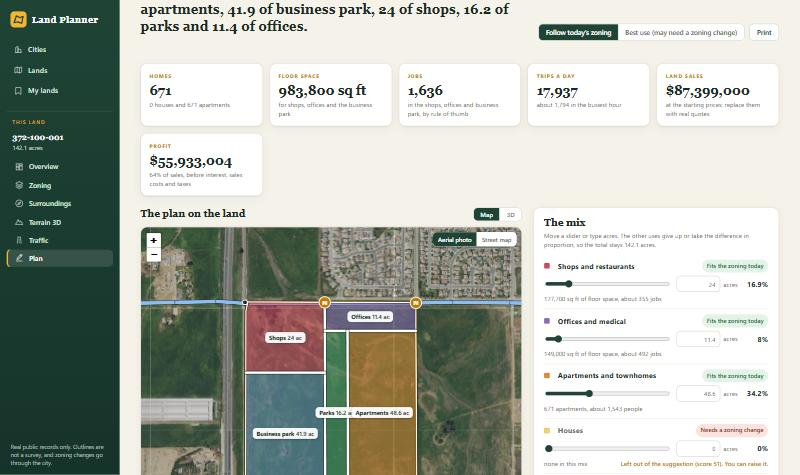
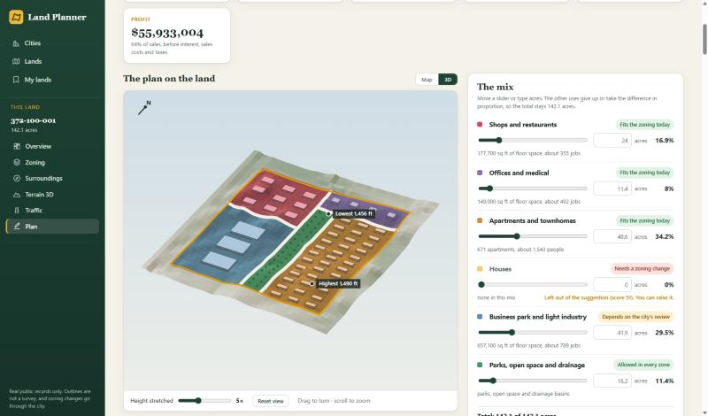
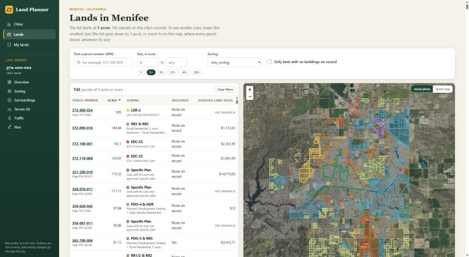
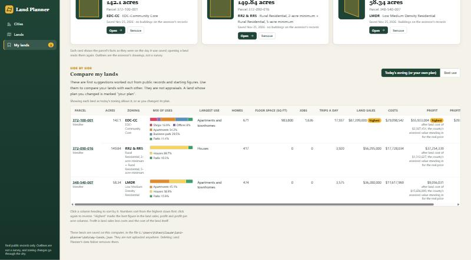

# Land Planner

Software for a land developer in Menifee, California: someone who buys a large piece of raw land, works with the
city to decide what each part of it may become, lays out the plan, and then sells the planned pieces to the
companies that build on them.

## Install on Windows: one click

### [Download Install-Land-Planner.bat](https://github.com/LILRINO71/land-planner/releases/latest/download/Install-Land-Planner.bat)

Double-click the downloaded file. About a minute later Land Planner opens in your browser, and a **Land Planner**
icon is on your Desktop and in the Start menu for next time.

- Nothing else to install: the app brings its own Python. No administrator rights needed.
- If Windows shows "Windows protected your PC", click **More info**, then **Run anyway**. The file is a short
  script (you can read it [here](Install-Land-Planner.bat)), not signed by a company.
- To update, run the same file again. Your saved lands and plans are kept.
- To remove it, delete the folder `%LOCALAPPDATA%\LandPlanner` and the two shortcuts.

Prefer one line? Paste this into PowerShell:

```powershell
irm https://raw.githubusercontent.com/LILRINO71/land-planner/main/install.ps1 | iex
```

Or without installing: download `LandPlanner.zip` from the [latest release](https://github.com/LILRINO71/land-planner/releases/latest),
unzip it anywhere and double-click `Start Land Planner.bat`. On Mac or Linux, or to work on the code, see
"The app" below (`python -m landplanner`).

## What it is for

The goal is a tool that looks at one piece of land and answers, with reasons he can check:

1. **What is this land?** Size, shape, slope, zoning, what the city's general plan intends, what surrounds it,
   which roads and how much traffic pass it.
2. **How should it be divided?** For example "of these 140 acres, about 25 for a shopping centre on the corner
   with the most traffic, 80 for homes, 15 for parks and drainage, the rest for roads", and why.
3. **Who would buy each piece?** Kinds of buyers and builders for each use (home builders, retail developers,
   apartment developers), and real companies active in the area.
4. **What would it cost and earn?** Grading, roads, utilities and fees against what the finished pieces sell for,
   with his own cost numbers imported from a spreadsheet.
5. **What would it look like?** A 3D view of the land with the proposed plan on it: blocks, roads, signals, and a
   "ten years from now" view.



| The plan in 3D | Every parcel on the aerial map | Saved lands side by side |
|---|---|---|
|  |  |  |

## What exists today

`tools/menifee.py` gets real public facts about any parcel in Menifee. No account or key is needed.

```
python tools/menifee.py parcels --min-acres 80 --vacant     large empty parcels, biggest first
python tools/menifee.py parcel 372100001                    one parcel: facts, centre point, outline
python tools/menifee.py site 372100001 --miles 1            the parcel and everything around it
python tools/menifee.py selfcheck                           did every data source answer just now?
```

### The app

From a copy of this repository: double-click `Start Land Planner.bat` (or run `python -m landplanner`). It starts a
small server on this computer only and opens the app in the browser. It needs Python 3 and nothing else. (The
installed version above needs nothing at all.) A new version is published by pushing a tag like `v2.0.1`: the
release workflow tests, builds and uploads it.

- **Cities**: Menifee today. A city is one adapter in `landplanner/cities/` (see `base.py`), so another city is
  added by writing one file for its public parcel and zoning records.
- **Lands**: the city's parcels as a sortable list and on an aerial-photo map. The list starts at 10 acres and
  can be lowered to 1; zoomed in, the map outlines every parcel of any size. Filter by size, zoning and "no
  buildings on record", search by parcel number, save one to My lands. Every map says when the city last changed
  its parcel records and when the aerial photo was taken.
- **My lands**: the parcels you saved, and a table that compares them side by side (mix, homes, jobs, trips, land
  sales, costs, profit) under today's zoning or best use.
- **Each land** has its own pages: Overview, Zoning, Surroundings, Terrain 3D, Traffic, and Plan.
  Surroundings also maps what is being built nearby (the city's project lists), schools and traffic signals;
  Overview links to Google Maps and Street View.
- **Plan** is the prediction: a suggested split of the land into shops, offices, apartments, houses, business
  park and parks, each with a score and the reasons behind it; the plan drawn on the parcel (map and 3D); who is
  building that kind of project nearby (from the city's own project lists); traffic, entrances and signals worth
  studying; a cost sheet you can edit or import from a .csv file; land sales and profit; jobs, residents and taxes.
  Two modes: follow today's zoning, or best use (what the location supports, which may need a zoning change).
  Every number is tagged as measured from a record or as a starting figure to replace with your own.

### Where your data is kept

Everything you save stays on this computer, in the `data/` folder beside the app. It is never uploaded and is not
part of the repository.

- `data/my-lands.json`: My lands.
- `data/plans.json`: your changes to each land's plan (acres, prices, costs, imported cost lines).
- `data/cache/`: copies of answers from the public services, so the app is quick; safe to delete.

Copy the `data/` folder to back it up or to move to another computer.

### How the prediction works

`landplanner/plan.py` scores each use from the facts the app holds: the zoning and what it is meant for, the
nearest state highway's traffic count (Caltrans), the class of the street the parcel fronts and existing signals
(city), people and homes within 1, 3 and 5 miles (2020 Census), the zoning of the land around it, the slope of the
ground (USGS), and what is on the city's project lists nearby. Shops are held to the size of centre the nearby
population supports; parks are sized from drainage and the new residents. `landplanner/geometry.py` then cuts the
parcel's outline into one piece per use: shops on the busiest street, business park toward the highway, houses at
the back, drainage toward the lowest ground. These are rules of thumb, stated on the page beside each result.

```
python -m unittest discover -s tests                offline checks (recorded answers, no network)
python tools/menifee.py selfcheck                   did every public source answer just now?
python tests/record_fixtures.py forecast            re-record the forecast's sources (needs the internet)
```

### When a source fails

Every figure comes from a public source, and each page says how each source answered: it answered, it answered
with nothing for this spot, it did not answer just now, it did not answer just now and the copy read earlier is
shown in its place (with the date that copy was read), or it answered in a form this app could not read. The last
one is never passed off as a silent service: it is written to `problems.log` in the `data` folder with where it
happened, so it can be mended. One failing source never takes a page down.

## How the forecast works

The Forecast page (`landplanner/forecast.py`) looks ten years ahead, year by year, for one parcel or for several
parcels treated as one site. Open it from a land's own page, or tick lands on My lands and forecast them together.

1. **Growth.** Homes within 1, 3 and 5 miles have a measured past (2010 and 2020 Census) and two official forecasts
   (the regional planning agency's adopted plan and its draft update). Each gives a yearly growth rate. The
   expected line follows the middle one; the low and high lines are the lowest and the highest. No rate is made up:
   when none answers, there is no forecast.
2. **Income areas.** Median household income, renters and owners by census tract (American Community Survey),
   with where incomes run higher and lower around the site.
3. **Needs, set beside what is already coming.** New homes a year are that growth. New shop space is what the new
   households' income supports. New work space is what the forecast jobs need. Each is shown beside the projects
   already on the city's lists, spread over the years they are likely to open by how far along each one is.
4. **Traffic.** The nearest highway count, grown with the homes around it, and the trips the site itself adds.
5. **The site's own land.** Its plan is taken up at the share of each year's need one site can win, which gives
   what can be sold in years 1 to 2, 3 to 5 and 6 to 10, and what would still be unsold. Neighbouring parcels in
   one zone are planned as one block, so the area's need for shops is counted once.

Everything that is not measured or an official forecast (the share of income spent in shops, floor space per job,
the share of demand one site wins and so on) is a starting figure shown on the page, and the owner can change it.

### The wider picture, and presenting it

Below the forecast the same page reads the rest of what a planning department asks about, each from a named public
source (`landplanner/sources/`, turned into findings by `landplanner/outlook.py`):

- **The city's economy by year**: people and homes (state estimates), homes permitted (Census Bureau), shop and
  restaurant sales (state tax agency), unemployment (state employment department), home-loan rates and prices.
- **Weather** since 1985 and where its trend points; **hazards and limits on building** (flood, fire, faults, soft
  ground, wetlands, protected habitat), each marked clear, know about it, or adds work.
- **What is close by** (parks, fire, police, hospitals, colleges, transit) and **who lives nearby**.
- **What needs to be done**: the steps with the city, the studies, the checks and when each part is offered, by
  year. A starting checklist drawn from the facts by simple rules; the city decides what it requires.

**Present to the city** (the button at the top of the Forecast page) shows all of it as full-screen slides for a
projector: arrow keys or a click to move, `F` for full screen, and Ctrl+P prints one slide per page as a handout.

## What it cannot tell you yet

- The shops and offices that exist today (no public list), so the forecast shows what growth adds, not whether the
  area is short of shops now.
- Traffic counts by year (only the latest highway count is published as open data).
- Traffic counts on city streets (only state highways are counted).
- Water, sewer and power capacity; airport noise and height zones (only the county serves them, behind a robot
  check); soil tests. Flood, fire, faults, wetlands and habitat are read, but a map is not a study.
- Real prices and quotes. The Plan page starts from editable figures; replace them with the owner's own.
- Which uses each zone allows outright, with a permit, or not at all (the city's table is not read yet; "fits the
  zoning" means "this is what the zone is for").
- City and agency fees.
- Riverside County's own parcel site blocks automated reading, so the city's copy is used instead.
- The aerial photo is the newest public one (its date is shown under each map); newer buildings are not in it.

## What it is not

Zoning and the general plan say what is allowed today. Changing a use goes through the city (general plan
amendment, zone change or specific plan, with public hearings). Parcel outlines are the assessor's drawings, not a
boundary survey. Anything this tool suggests is a starting point for the people whose job it is to decide: the
owner, his engineer and the city's planners.

## Build order

1. The app: cities, lands, My lands and each land's own pages. *(done)*
2. Land-use mix with reasons, adjustable by hand. *(done)*
3. The plan on the land, as a map and in 3D. *(done)*
4. Costs and returns, with imported cost lines. *(done, from starting figures)*
5. Buyers and builders per use, from the city's project lists. *(done)*
6. Traffic, entrances, signals; jobs, residents and taxes. *(done)*
7. The ten-year forecast for one parcel or several as one site. *(done)*
8. The wider picture: the city's economy, weather, hazards, what is close by, residents, the steps to take. *(done)*
9. Present to the city: the same facts as full-screen slides that print one per page. *(done)*
10. Next: real quotes from the owner; the zone-by-zone table of allowed uses; a second city.
